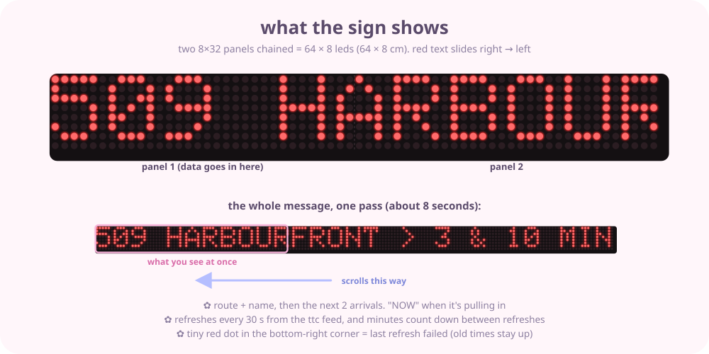
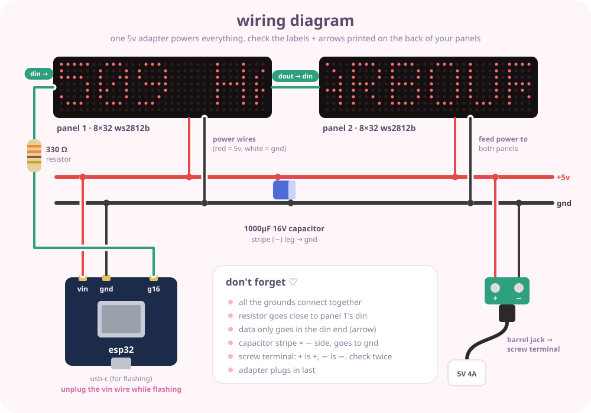

<p align="center">
  
</p>

<p align="center">
  
</p>

<p align="center">
  
  
  
  
</p>

## ✿ what is this

i'm always checking the ttc app on my way out the door, so i'm making a little station sign for my wall instead 🎀

it's an esp32 + two 8×32 led panels chained into one long 64 × 8 cm strip. every 30 seconds it asks the ttc's live feed when the next **509 to union station** is coming to my stop, and scrolls it right → left in red, like the real signs:

```
509 HARBOURFRONT > 3 & 10 MIN
```

this is my second wall build, the first one is my [github led wall](https://github.com/sillycat79/github-led-wall) ♡

<p align="center">
  
</p>

## 🚋 picking the stop

set your stop id at the top of `ttc_ticker.ino`. find it on google maps (it's right under the stop name) or on the pole at the stop. no api key needed, the ttc's real-time feed is public.

by default it only shows trips headed to union station (`DIRECTION_MATCH = "Union"`), so routes going the other way get hidden. set it to `""` to show everything at the stop.

## 🛍️ hardware

everything from amazon.ca, prices in CAD:

| | part | notes | price |
|---|---|---|---|
| 1 | **2× 8x32 led matrix, ws2812b, flexible** | 256 leds each, **5v**. ~32 × 8 cm each, chain them for 64 × 8 | $56.68 |
| 2 | **elegoo esp32, 2-pack** | usb-c, cp2102. a regular esp32 (wroom-32) | $20.99 |
| 3 | **facmogu 5v 4a adapter** | 5.5 × 2.1 mm barrel. **5v only** | $15.99 |
| 4 | **female dc barrel jack → screw terminal (20 pcs)** | 5.5 × 2.1 mm, matches the adapter | $11.99 |
| 5 | **swpeet electrolytic capacitor kit** | using the **1000µF 16V** one | $16.99 |
| 6 | **elegoo resistor kit** | using a **330 Ω** one | $13.59 |
| 7 | foam board strip, ~65 × 9 cm | backing so the flexible panels stay flat. dollar store | ~$2 |
| | usb-c cable | my mac charger cable, just for flashing | — |
| | dupont jumper wires | left over from the github wall | — |
| | | | **~$138** |

> **check before buying:** the panel listing should say **ws2812b** and **5v**. ws2815 panels are 12v and need a different adapter.

the panels draw way less than you'd think: only red, at low brightness. even with every led lit it's under 1 a, and the code caps it at 3.5 a just in case.

## 🛠️ wiring

<p align="center">
  
</p>

1. **chain the panels**: plug panel 1's **dout** connector into panel 2's **din**. look for the little arrow on the back, data flows the way it points
2. **power**: each panel has extra red (5v) + white (gnd) wires. twist both reds together into the screw terminal's **+**, both whites into **−**
3. **capacitor**: across the screw terminal, long leg to **+**, striped leg to **−**
4. **esp32 power**: a jumper from **+** to the esp32's **vin**, and from **−** to **gnd**
5. **data**: esp32 **gpio 16** → 330 Ω resistor → panel 1's **din** wire (usually green). keep the resistor close to the panel
6. plug in the adapter last ✨

> unplug the vin wire whenever the usb-c cable is plugged in for flashing, so the esp32 isn't getting power from two places.

## 💻 software setup

already have arduino ide 2 + esp32 boards from the github wall, so just:

1. library manager → install:
   - **FastLED** (by daniel garcia)
   - **Adafruit GFX Library**
   - **ArduinoJson** (by benoit blanchon), already installed if you built the github wall
2. in `firmware/ttc_ticker/`, copy `secrets.example.h` → `secrets.h` and add your wifi (2.4 GHz)
3. board: **ESP32 Dev Module** → upload ✨

on boot it shows `hi :)` on the left panel, then `LOADING TTC...`, then the times.

### ✿ settings

all at the top of `ttc_ticker.ino`:

| setting | default | what it does |
|---|---|---|
| `STOP_IDS` | `"YOUR_STOP_ID"` | which stop(s) to check |
| `DIRECTION_MATCH` | `"Union"` | only show trips headed there. `""` = everything at the stop |
| `ARRIVALS_PER_ROUTE` | `2` | `3 & 10 MIN` |
| `SCROLL_MS` | `35` | lower = faster scrolling |
| `BRIGHTNESS` | `40` | 0–255 |
| `NIGHT_START_H` / `NIGHT_END_H` | `23` / `7` | dims to `NIGHT_BRIGHTNESS` overnight |
| `COLOR_TEXT` | red | `CRGB(255, 120, 0)` for amber ✿ |

### if something's off

- **`hi :)` is mirrored** → set `FLIP_X true`
- **upside down** → set `FLIP_Y true`
- **every other column is scrambled** → set `SERPENTINE false`
- **only panel 1 lights up** → panel 1's dout isn't plugged into panel 2's din
- **random colors / flickery first pixel** → check the gnd wire between the esp32 and the panels, and that the 330 Ω is there. still flickery? the esp32 talks at 3.3 v and the panels want 5 v. a 74AHCT125 level shifter fixes it
- **tiny red dot bottom-right** → the last refresh failed (wifi or the ttc feed). old times stay up
- **`NOTHING COMING RIGHT NOW`** → no 509s predicted (late at night, or a diversion)
- **mac doesn't see the board** → install the silicon labs cp210x driver, and make sure it's a data cable

## 🌷 to be added

- [ ] **diffuser**: smoked acrylic or a strip of black window tint over the leds so it looks like a real sign
- [ ] **frame**: thin black frame / 3d-printed channel around the strip
- [ ] **service alerts**: scroll ttc alerts for the 509 when there's a diversion
- [ ] **hide the wiring** with a stick-on cord cover down to the outlet
- [ ] **weather** between arrivals so i know if i need a jacket 🧥

## 📸 the real thing

coming soon! final pics go in [`photos/`](photos/) ♡

<!--
<p align="center">
  
</p>
-->

---

<p align="center">arrival data from the ttc's public real-time feed · not affiliated with the ttc</p>
<p align="center">made with ♡ by <a href="https://github.com/sillycat79">sillycat79</a> · <a href="https://sillycat79.com">sillycat79.com</a></p>
